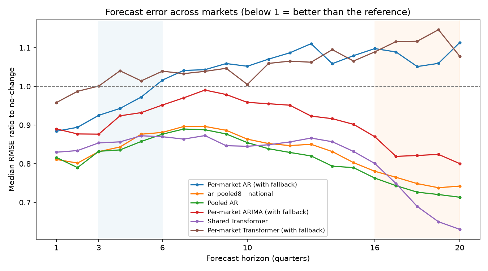

# Multi-Market Housing Price Forecasting

Can one Transformer forecast house prices across countries? This project compares a shared model with separate market models and statistical baselines, tests larger training pools and local fine-tuning, and forecasts markets left out of training. Exploratory analyses examine which past quarters influence predictions and whether CPI or policy signals improve accuracy.

The main study uses national real house price indices from OECD AnaHPI and Taiwan’s Sinyi index. Final testing is complete: 48 markets were scored, using the frozen HPI-only setup at commit `b474b77`. [Test plan](docs/freeze.md) · [Run record](results/test_run_info.txt)

## Setup

- **Input and target:** eight quarters of real HPI growth → cumulative real HPI growth 1–20 quarters ahead. Focus: 3–6 and 16–20 quarters.
- **Evaluation:** expanding training windows, refitting every four quarters, five Transformer seeds. Validation origins: 2000–2009; test origins: 2015–2025, ending earlier at longer horizons.
- **Timing:** forecasts use a common date 122 days after quarter-end; scaling and label availability are controlled within training.
- **Baselines:** per-market Transformer, per-market AR and ARIMA, pooled AR(4), pooled AR(8), and no-change.

## Main results

Entries are median market RMSE(shared) / RMSE(baseline). **Below 1 favors the shared Transformer.** Brackets are 95% paired bootstrap intervals using 20-quarter blocks.

| Shared Transformer vs | Test, 3–6 quarters | Test, 16–20 quarters |
|---|---:|---:|
| Per-market Transformer | 0.878 [0.746, 0.966] | 0.805 [0.681, 0.997] |
| Per-market AR | 0.931 [0.868, 1.000] | 0.901 [0.790, 0.975] |
| Per-market ARIMA | 0.978 [0.872, 1.048] | 1.015 [0.789, 1.139] |
| Pooled AR(4) | 1.013 [0.944, 1.072] | 0.917 [0.872, 1.157] |
| Pooled AR(8) | 1.002 [0.929, 1.061] | 0.871 [0.821, 1.125] |
| No-change | 0.870 [0.707, 1.110] | 0.698 [0.597, 1.062] |

The shared model outperformed separate Transformers in both ranges across all four block lengths checked. Its long-horizon advantage over per-market AR also held on the full 48-market sample. Comparisons with pooled AR, ARIMA and no-change remain uncertain. These conclusions depend partly on market composition: on the 38 markets scored in both periods, the long-horizon intervals against separate Transformers and AR include 1.



Other findings:

- **More training markets:** validation gains did not carry into testing. On the same five evaluation markets, the fixed 41-market pool had 69% higher long-horizon RMSE than the five-market pool. Its forecasts shifted upward, helping some markets and hurting others; this does not establish the cause of the reversal.
- **Fine-tuning:** neither setup improved overall test accuracy. Portugal’s validation gains did not generalize.
- **Market holdouts:** excluding a target market changed test error by about −2% to +6% relative to including it, with all intervals including 1. Performance against simple baselines varied by market.
- **Exploratory validation:** both Transformer and AR rely most on the latest quarter, while Transformer sensitivity varies with market conditions. The Transformer was more sensitive to input noise. CPI and iMaPP policy features showed no clear accuracy gain; the LLM-derived Taiwan policy index has not been tested for forecasting.

[Detailed results](docs/results.md) include validation comparisons, common-market checks, forecast bias, attribution and policy experiments.

## Limitations

Validation and test differ in periods and market coverage. Long-horizon targets overlap and offer few independent forecast dates. Historical release timing and revised HPI vintages remain uncertain; 122 days is an assumption based on recent Chilean nominal-HPI releases. Most test markets rose in real terms over the long-horizon forecast samples, which matters when interpreting no-change comparisons. Taiwan’s 2015–2017 short-horizon test overlaps the earlier pilot.

Relative improvements do not establish accuracy sufficient for housing decisions. Exploratory analyses use validation data only. Remaining work is the final report and presentation.

## Run locally

Use Python 3.11 from the repository root.

```bash
conda create -n hpf python=3.11 -y
conda activate hpf
pip install -e ".[dev,dl,stats]" matplotlib
pytest -q
python scripts/build_panel.py
```

Run the frozen final-test pipeline:

```bash
bash scripts/run_test_122.sh
```

[Reproduction commands](docs/reproducing.md) cover validation, secondary experiments and exploratory checks. The test runner checks completed outputs before reusing them and archives interrupted runs.

## Repository

| Path | Contents |
|---|---|
| `src/housing_forecast/` | Data preparation, models, backtest and evaluation |
| `scripts/` · `configs/` | Experiment commands and settings |
| `results/` | Saved forecasts, metrics, intervals and figures |
| `tests/` | Data, model and evaluation checks |

[Backtest framework](docs/backtest_framework.md) · [Market coverage](docs/market_list.csv) · [Release timing](docs/hpi_release_lags.md) · [Taiwan pilot](docs/taiwan_pilot.md)
