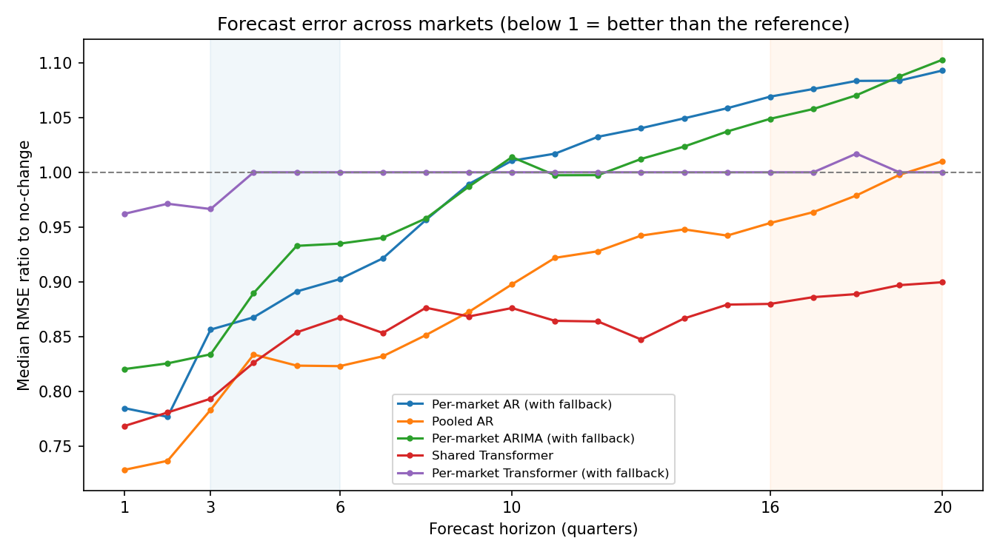
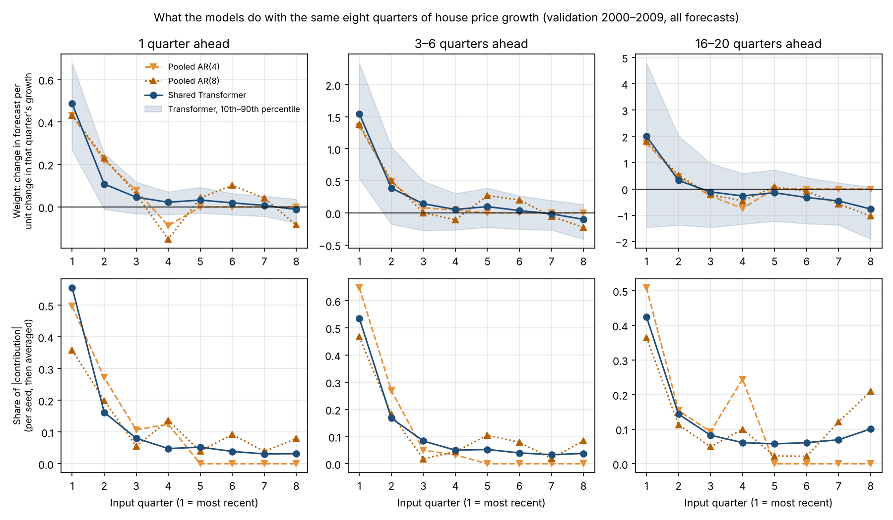
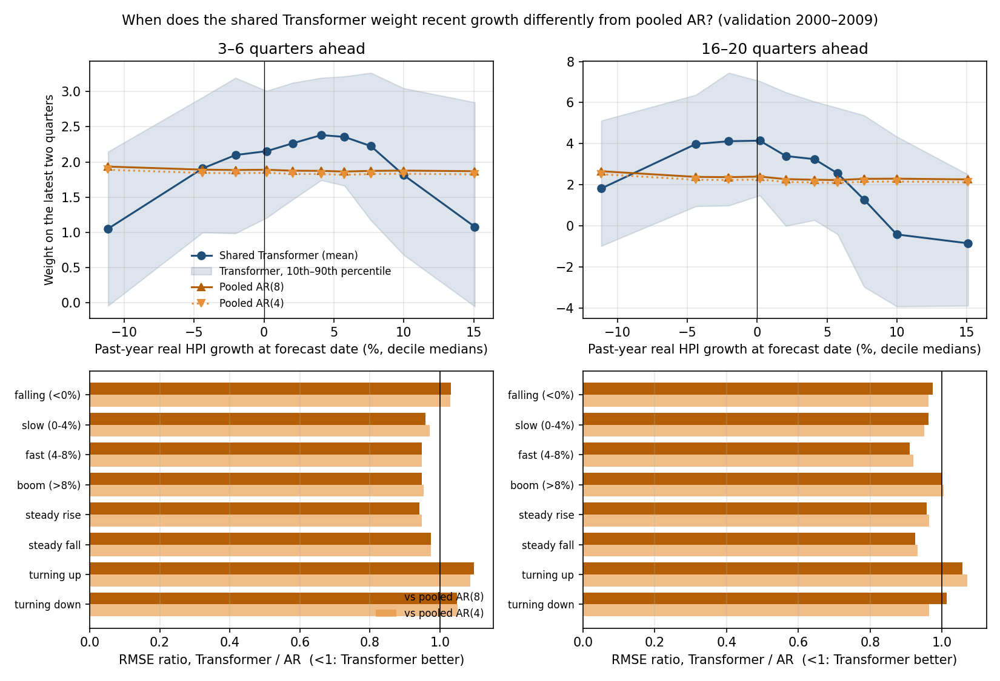
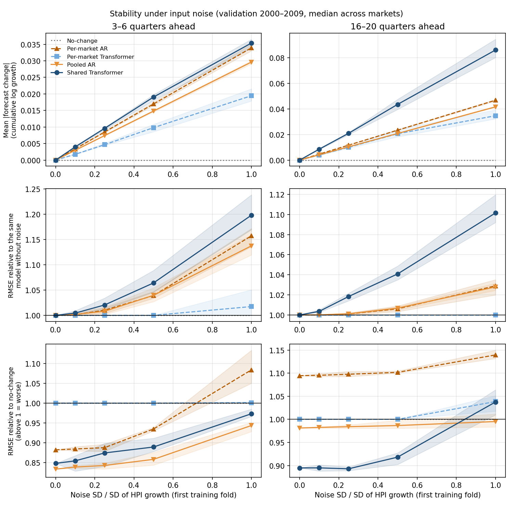

# Multi-Market Housing Price Forecasting

This project studies whether a single Transformer can forecast house prices across countries. We compare it with separate models for each market, test larger training pools, and forecast countries left out of training. The aim is to explore how far a shared model can carry across housing markets, including markets with short data histories.

The study asks three questions:

1. Can one shared model serve many housing markets?
2. How does it compare with fitting a separate model for each market?
3. How does forecast accuracy change from 1 to 20 quarters ahead?

The work started with Taiwan and now uses national house price series from OECD AnaHPI alongside Taiwan's Sinyi index. The main experiments use house price history alone and forecast 1 to 20 quarters ahead. We focus on 3–6 quarters for buying or selling and 16–20 quarters for construction. Earlier Taiwan experiments also included economic indicators and compared joint training with pretraining followed by fine-tuning. [Taiwan pilot](docs/taiwan_pilot.md)

The repository contains the data preparation code, a common backtest for all models, saved forecasts, error tables and plotting scripts. The results here are validation results. Final testing is still pending.

## Findings so far

1. **Market coverage.** One shared Transformer produced forecasts for 41 national markets, with 38 included in the main comparison. The full training pool improved 3–6-quarter forecasts, while the intermediate results varied across three orders of adding markets. The four market holdouts gave examples of forecasting without local training data.
2. **Accuracy against separate models.** The shared model had lower error than separate Transformers and, from 5 quarters ahead, separate AR models across all four block lengths checked. The shared model also had lower error than per-market ARIMA at 16–20 quarters across all four block lengths. Pooled AR was much closer to the shared Transformer. Fine-tuning a copy for each market did not improve on the shared model overall, although Germany and Portugal benefited.
3. **Forecast horizon.** The advantage over separate Transformers was larger at longer horizons, where absolute errors also grew. Against no-change, only the 1–3-quarter improvement held across all block lengths. Accuracy sufficient for buying, selling or construction decisions still needs to be established.

## Data and backtest

- **Model:** a small Transformer takes eight quarters of inflation-adjusted house price growth and predicts the total log change over each of the next 1–20 quarters.
- **Data:** national HPI series from OECD AnaHPI and Taiwan's Sinyi index. We build the panel from raw observations and adjust Taiwan's nominal HPI with CPI. Taiwan's index is not seasonally adjusted, while the OECD series are. We generated forecasts for 41 markets and report the 38 with at least eight forecast dates. [Market coverage](docs/market_list.csv) · [Data evidence](TODO_B.md) · [HPI release timing](docs/hpi_release_lags.md)
- **Backtest:** validation origins run from 2000Q1 to 2009Q4. We expand the training window and refit every four quarters. Training origins are at least four quarters earlier than the first validation origin in each fold. Scaling uses training data only, and training labels are masked until their estimated publication date. The main comparison uses a common forecast date 122 days after quarter-end, based on two recent releases of Chile’s nominal HPI. Historical release timing and the first availability of the OECD real series remain uncertain.
- **Baselines:** a Transformer trained separately for each market (it falls back to no-change when a market has too little history), per-market AR (falls back to pooled AR), per-market ARIMA (falls back to its own average growth when history is too short or a fit fails), one pooled AR across markets, and no-change.
- **Scoring:** RMSE per market and horizon, averaged over five seeds for each Transformer. We report the median across markets of RMSE(shared) / RMSE(baseline), so a ratio below 1 favors the shared model. Brackets are 95% intervals from a paired block bootstrap over forecast dates with 20-quarter blocks. We also check 4-, 8- and 12-quarter blocks. [Block-length check for the main, training-pool and holdout comparisons](results/block_length_sensitivity_122.csv)

## Multi-market results

We use a common forecast date of 122 days after quarter-end and keep Chile in the 41-market pool. The main comparison, training-pool, holdout and fine-tuning runs were repeated at 122 days. The median RMSE ratios for the 3–6 and 16–20 quarter ranges moved by about 0.006 or less. Earlier runs are in `results/long_hpi` and commit `d48a065`.

### Shared and per-market models

| Shared Transformer vs | 3–6 quarters | 16–20 quarters |
|---|---:|---:|
| Per-market Transformer | 0.896 [0.802, 0.931] | 0.806 [0.797, 0.862] |
| Per-market AR | 0.944 [0.884, 0.978] | 0.869 [0.797, 0.956] |
| Per-market ARIMA | 0.947 [0.857, 1.000] | 0.913 [0.841, 0.980] |
| Pooled AR | 0.979 [0.919, 1.058] | 0.955 [0.918, 1.011] |
| No-change | 0.848 [0.651, 0.979] | 0.895 [0.833, 1.029] |

- **Per-market Transformer:** the interval is below 1 at every horizon and block length. About 23% of its forecasts were no-change fallbacks. Keeping only forecasts where both Transformers were trained (24 markets with medium or long histories) gives 0.822 [0.794, 0.899] and 0.792 [0.783, 0.839]. [Fitted-only check](results/long_hpi_122/validation/fitted_only_ratio_ci.csv)
- **Per-market AR:** the interval is below 1 from 5 quarters on at every block length.
- **Per-market ARIMA:** the order (p ≤ 4, q ≤ 2) is chosen by AIC on each market's training history. Markets with fewer than 24 training quarters use their own average growth; this covers about 20% of forecasts, and no fit failed. The interval is below 1 at 16–20 quarters and includes 1 at 3–6 quarters for all four block lengths. Like per-market AR, it is about even with or behind no-change from 10 quarters on (1.10 at 20 quarters). [ARIMA fits and fallbacks](results/long_hpi_122/validation/diag_arima__national.csv)
- **Pooled AR:** its errors are close to the shared Transformer's, and the intervals include 1 in both ranges. Giving pooled AR the same eight quarters of history (AR(8)) did not help it: against AR(8) the ratios are 0.983 [0.916, 1.052] and 0.945 [0.902, 1.004]. The next section looks at how the two models use the same inputs.
- **No-change:** at 3–6 quarters the interval includes 1 with 8- or 12-quarter blocks.

**Training cost.** Over the 10 validation folds and five seeds, the shared Transformer trains 50 networks, while one Transformer per market trains 1,165. Shared-model fits include an extra training run to choose the epoch count. Per-market models do this when enough history is available. The per-market count excludes markets that fell back to no-change. On one Apple-silicon CPU thread, the largest fold took 5.5 seconds for the shared model and 7.7 seconds for the per-market models, with one seed. The timing difference was small in this single-fold measurement. The shared approach uses one model across markets, while the per-market approach needs a separate model for each market with enough history. The shared model also covers markets too short to train on their own. Fine-tuning took 6.4 seconds with fixed epochs and 18.3 seconds with epochs chosen inside training. Both AR baselines took under 0.2 seconds. The timings were measured with the 100-day setup, which has the same folds and models. [Model counts](results/training_cost.csv) · [Timing](results/training_time.csv)

### Shared pretraining and local fine-tuning

We adapted a copy of the shared model to each market's own training history. Each fold starts from one shared model trained on the available markets, including each target market's past data. The holdout experiment below instead excludes the target market from training. Each market's copy keeps the shared scaling and uses a learning rate of 0.0001. Markets with fewer than 24 training rows keep the shared forecast. We tried two settings:

- **Fixed:** every eligible market is fine-tuned for 10 epochs.
- **Chosen inside training:** added after we had seen the fixed results. Within each fold, the training data are split by date: the shared model is pretrained and rescaled on the earlier part, and each market's epoch count, from 0 (keep the shared model) to 30, is chosen on the later part. The model is then refitted on the full fold with the chosen counts. Markets without enough rows in the earlier part keep the shared model.

Ratios compare fine-tuning with the exact shared model it started from; both settings start from identical shared forecasts. Below 1 favors fine-tuning. The two rows use different market samples, so they should not be compared with each other.

| Setting | Markets compared | 3–6 quarters | 16–20 quarters |
|---|---:|---:|---:|
| Fixed 10 epochs (folds where all seeds were fine-tuned) | 24 | 1.022 [0.985, 1.038] | 1.038 [0.994, 1.081] |
| Chosen inside training (folds where a choice was made) | 22 | 1.020 [1.000, 1.037] | 1.032 [0.995, 1.046] |

**Neither fine-tuning setting showed an overall improvement, but some markets benefited.** Among the markets and folds included in the table, median error was about 2–4% higher than with the shared model. Most intervals include 1; the exception is the chosen setting at 3–6 quarters with 4-quarter blocks, where the interval lies just above 1. When a choice was possible, the training data favored keeping the shared model 42% of the time. Most short-history markets, including Taiwan, did not have enough data for fine-tuning under these rules, so we could not assess its benefit there. Both settings still beat the separate Transformers trained from scratch; for the fixed setting the ratios were 0.896 [0.779, 0.938] and 0.847 [0.832, 0.898].

Germany and Portugal, two of the shared model's weakest markets, improved in both settings. The chosen setting fine-tuned them in every fold and seed where a choice was possible. Over all of each market's forecasts:

| Market | Setting | 3–6 quarters | 16–20 quarters |
|---|---|---:|---:|
| Germany | Fixed | 0.735 [0.654, 0.788] | 0.649 [0.622, 0.672] |
| Germany | Chosen | 0.690 [0.621, 0.733] | 0.540 [0.519, 0.570] |
| Portugal | Fixed | 0.884 [0.794, 0.921] | 0.852 [0.819, 0.889] |
| Portugal | Chosen | 0.894 [0.835, 0.958] | 0.826 [0.757, 0.925] |

All eight intervals stay below 1 with 4-, 8-, 12- and 20-quarter blocks. Fine-tuning narrows these markets' gap rather than closing it: after the chosen fine-tuning, Germany's 16–20-quarter error is still about 11% above per-market AR (1.108 [1.041, 1.170]) and both markets remain above no-change in that range. We picked these two markets as examples after seeing the fixed results, so they show where local adaptation can help rather than a tested selection rule. Other markets lost accuracy, for example Switzerland (1.41 fixed, 1.15 chosen at 16–20 quarters). [Fixed setting](results/market_finetune_122/validation) · [Chosen setting](results/market_finetune_122/inner_select/validation) · [Germany and Portugal intervals](results/market_finetune_122/case_markets_ci.csv)

### Accuracy by horizon



The per-market Transformer falls back to no-change when local history is too short. These fallbacks are included in the curve. The fitted-only comparison above checks whether the shared model still performs better when both Transformers were actually trained.

The curves compare the shared Transformer and four baselines with no-change. The shaded ranges mark 3–6 and 16–20 quarters. The shared Transformer's median ratio to no-change stays between 0.77 and 0.90 at every horizon, while per-market AR falls behind no-change from 10 quarters on (1.09 at 20 quarters). The RMSE ratio against the per-market Transformer falls from about 0.88–0.90 at 1–8 quarters to 0.80–0.83 at 12–20 quarters. Absolute error grows fast: the shared model's median RMSE is 0.017 at one quarter and 0.235 at 20 quarters, in cumulative log growth. Whether errors of that size are useful for construction decisions is still open. [Errors by market and horizon](results/long_hpi_122/validation/metrics_by_market.csv)

### Training on more markets

We trained on nested pools of 5, 10, 20 and 41 markets in three orders, always scoring the same five markets on the same dates. Ratios below 1 mean lower error than the five-market run. The 5- and 41-market pools are identical across orders, so those forecasts are reused.

| Order of adding markets | Markets on the list | Markets used per fold | 3–6 quarters | 16–20 quarters |
|---|---:|---:|---:|---:|
| Common starting pool | 5 | 3–5 | Reference | Reference |
| Region rotation | 10 | 7–10 | 0.922 [0.797, 0.978] | 0.925 [0.798, 1.080] |
| Region rotation | 20 | 15–20 | 1.002 [0.862, 1.039] | 0.905 [0.679, 1.136] |
| Long history first | 10 | 8–10 | 0.999 [0.761, 1.063] | 0.895 [0.670, 1.073] |
| Long history first | 20 | 18–20 | 0.913 [0.858, 0.978] | 0.835 [0.619, 1.079] |
| Fixed random order | 10 | 6–10 | 0.907 [0.801, 0.949] | 0.994 [0.877, 1.045] |
| Fixed random order | 20 | 11–19 | 0.883 [0.834, 0.951] | 0.836 [0.696, 1.119] |
| Common full pool | 41 | 24–38 | 0.912 [0.802, 0.972] | 0.818 [0.651, 0.982] |

The intermediate results depend on which markets are added. At 20 markets, the 3–6-quarter error was about even with the five-market run under region rotation, 9% lower with long histories first and 12% lower with the random order. More markets did not improve every step.

The full pool lowered error by about 9% at 3–6 quarters and 18% at 16–20 quarters. The shorter-range interval stays below 1 at all block lengths checked. The longer-range interval includes 1 with 8- or 12-quarter blocks, and only three of the five markets improved in that range. [Market selection](docs/market_selection.md) · [Region rotation](results/market_scale_122/validation) · [Long history first](results/market_scale_122/history/validation) · [Random order](results/market_scale_122/random/validation)

### Forecasting a market left out of training

We left out Australia, Chile, Taiwan and Portugal one at a time. At forecast time the model still sees that market's own recent HPI history. Ratios below 1 favor the model that never trained on the market.

| Held-out market | Dates | vs included, 3–6 q | vs included, 16–20 q | Against AR and no-change |
|---|---:|---:|---:|---|
| [Australia](results/market_holdout_122/australia/validation) | 40 | 1.007 [0.987, 1.038] | 1.009 [0.979, 1.043] | Intervals against both include 1 in these ranges |
| [Chile](results/market_holdout_122/chile/validation) | 24 | 1.015 [0.982, 1.041] | 0.901 [0.872, 0.947] | Better than both at 16–20 q; worse than AR at 3–6 q |
| [Taiwan](results/market_holdout_122/taiwan_national/validation) | 28 | 1.011 [1.005, 1.024] | 0.990 [0.979, 1.008] | About even with no-change; error about 24% above AR at 16–20 q, but this gap depends on block length |
| [Portugal](results/market_holdout_122/portugal/validation) | 40 | 0.956 [0.919, 0.978] | 1.009 [0.991, 1.030] | Worse than both at 16–20 q |

Leaving a market out usually changed RMSE by a few percent. Each held-out market supplied at most about 5% of the original training rows. The held-out model beat simple baselines in Chile at long horizons, while it over-predicted Portugal's five-year growth whether or not Portugal was in training. Chile's 10% gain at 16–20 quarters and Taiwan's gap to AR are not robust: their intervals include 1 with 8- or 12-quarter blocks. Except for Taiwan's noted gap to AR, the last column highlights comparisons that hold across the four block lengths checked. Each held-out model is compared with a single-thread run of the shared model, trained the same way; it matches the main 122-day run exactly. Multi-threaded runs can differ by a few percent, so small gaps between the Transformers need care.

## Why the shared Transformer differs from pooled AR

Pooled AR and the shared Transformer see the same data: eight quarters of real house price growth from the same markets. Pooled AR turns them into a forecast with fixed coefficients. The Transformer has no coefficients, so we measured the equivalent for each validation forecast: how much the forecast changes when one input quarter changes (its local weight), and how much each quarter moved the forecast away from the forecast for an average input (Integrated Gradients). We retrained the shared model exactly as in the main run; its forecasts match the saved ones to within 2×10⁻⁷. We compare it mainly with pooled AR(8), which uses the same eight quarters.



**On average the models use the inputs in a similar way.** All of them rely most on the latest quarter: it accounts for 52% of the Transformer's movement in 3–6-quarter forecasts and 41% at 16–20 quarters, against 47% and 37% for AR(8). All of them also give older quarters negative weight at long horizons, so a strong rise one or two years ago lowers the five-year forecast. The Transformer leans a little more on the latest quarter, which fits the noise check in the next section: errors in recent data move its forecasts more.

**The difference is that the Transformer changes its weights with the situation.** Pooled AR uses one set of coefficients for every market and date in a fold. The Transformer's weight on the latest two quarters varies widely between forecasts, even within one fold (a standard deviation of 3.1 at 16–20 quarters, against 0 for AR). Grouping forecasts by the growth over the past year shows the pattern:



| Past-year growth at the forecast date | Transformer weight on latest two quarters | AR(8) | Transformer weight on quarters 5–8 | AR(8) | RMSE, Transformer / AR(8) |
|---|---:|---:|---:|---:|---:|
| Falling (below 0%) | 3.42 | 2.46 | −0.86 | −1.50 | 0.974 |
| Slow (0–4%) | 3.64 | 2.32 | −1.87 | −1.63 | 0.962 |
| Fast (4–8%) | 2.31 | 2.23 | −2.31 | −1.74 | 0.911 |
| Boom (above 8%) | −0.36 | 2.28 | −2.18 | −1.67 | 1.001 |

Weights are for the 16–20-quarter range. In normal or falling markets the Transformer follows the latest trend more strongly than AR(8). After a strong boom it stops extending the recent rise and relies more on the expectation that prices fall back. AR(8) extends the trend in the same way whatever the situation.

**This helps in some markets and hurts in others.** The Transformer had lower error than AR(8) when trends were steady (0.925 for steady falls and 0.958 for steady rises at 16–20 quarters) and higher error at turning points (1.06 at 16–20 quarters and 1.10 at 3–6 quarters when prices had just turned up). In markets where it stopped extending booms, such as the Slovak Republic, Bulgaria and Latvia, its 16–20-quarter error was 10–48% lower than AR(8)'s. In markets where it extended recent trends strongly, such as Germany, the Netherlands and Mexico, its error was 21–58% higher. Germany and Mexico are also among its weakest markets in the main comparison.

These group results are descriptive: they pool forecasts across markets and have no confidence intervals. Booms are concentrated in 2003–2007 and in a few Central and Eastern European markets, so the effect of a boom cannot be fully separated from the effect of those markets. The Integrated Gradients results do not depend on the number of integration steps: from 32 to 512 steps, each quarter's share changed by at most 0.0005 and the ranking of quarters did not change. [Lag weights](results/explain/validation/lag_weights.csv) · [By situation](results/explain/validation/weights_by_regime.csv) · [By market](results/explain/validation/weights_by_market.csv) · [Checks](results/explain/validation/ig_steps_check.csv)

## Stability and an extra input

These two checks were added after the professor asked for more evidence on how the models behave. Both use the validation folds only.

### Noise in the input data

We trained every model as in the main comparison, then repeated its forecasts with Gaussian noise added to the input house price growth. Each market and quarter gets one fixed error per draw, so overlapping input windows, folds and models all see the same error, as if one historical value had been measured wrongly. The noise standard deviation is a multiple of the standard deviation of house price growth in the first training fold (0.026). Training data were not changed. Each level uses three draws.



| Noise level | Shared Transformer, 3–6 q | Pooled AR, 3–6 q | Shared Transformer, 16–20 q | Pooled AR, 16–20 q |
|---|---:|---:|---:|---:|
| 0.25 | +2.0% | +0.8% | +1.8% | +0.1% |
| 0.5 | +6.4% | +4.0% | +4.1% | +0.7% |
| 1.0 | +19.8% | +13.7% | +10.2% | +2.8% |

The table shows the median increase in RMSE compared with the same model without noise. **The shared Transformer reacts more to noise than the AR models.** Its long-range forecasts move about twice as much (mean absolute change 0.086 against 0.042 for pooled AR at level 1). At noise level 0.5, the median 16–20-quarter RMSE ratios to no-change were 0.92 for the shared Transformer and 0.99 for pooled AR. At level 1, they were 1.04 and about 1.00. The per-market Transformer looks flat, but mainly because many of its forecasts are no-change fallbacks, which ignore the inputs. [Results](results/robustness/noise/validation)

### Adding CPI inflation

We repeated the comparison with year-on-year CPI inflation as a second input. Both versions use exactly the same samples: a sample is kept only if its eight-quarter window has both house price growth and CPI, and the house-price-only version drops the CPI column. The backtest assumes CPI is available 30 days after quarter-end. 38 markets are compared, as in the main study; New Zealand, Russia and Ireland lose some early training rows because their CPI series start later or have a gap. [CPI coverage and outliers](docs/cpi_assessment.csv)

| Comparison | 3–6 quarters | 16–20 quarters |
|---|---:|---:|
| Shared Transformer: with CPI vs without | 1.026 [0.988, 1.048] | 1.030 [0.950, 1.100] |
| Pooled AR: with CPI lags vs without | 0.989 [0.951, 1.008] | 0.971 [0.919, 1.056] |
| With CPI: shared Transformer vs pooled AR | 0.994 [0.942, 1.040] | 0.960 [0.907, 1.074] |

**Adding CPI showed no clear improvement for either model.** All reported intervals include 1. [Results](results/cpi/validation)

## Limits and remaining work

- The results cover one validation period, which includes the 2008 crisis. The proposed test starts in 2015 and overlaps years examined in the earlier Taiwan pilot. [Taiwan pilot](docs/taiwan_pilot.md)
- Most comparisons have 40 forecast dates, so a draw with 20-quarter blocks uses only two blocks. Claims that depend on the block length are marked above.
- Taiwan remains a difficult case. Its shared-model errors are close to no-change in the ranges shown here.
- The broader study still needs the final test. We have recent release examples for 32 markets and schedule estimates for two more. Availability of the real HPI during 2000–2009 remains uncertain.
- The noise, CPI and explainability checks were added after the main design was fixed, so they are reported as exploratory results.

## Run locally

Use Python 3.11 from the repository root.

```bash
conda create -n hpf python=3.11 -y
conda activate hpf
pip install -e ".[dev,dl,stats]" matplotlib
pytest -q
python scripts/build_panel.py
```

Main comparison at 122 days:

```bash
C=configs/experiment_long.toml
D=results/long_hpi_122/validation
OMP_NUM_THREADS=1 python scripts/run_backtest.py --config "$C" --models no_change ar ar_pooled arima transformer transformer_per_market --pool national --experiment long_hpi_122
python scripts/evaluate_markets.py "$D"/preds_*.csv --config $C --reference no_change__national \
    --compare transformer__national transformer_per_market__national \
    --compare transformer__national ar__national \
    --compare transformer__national arima__national \
    --compare transformer__national ar_pooled__national \
    --compare transformer__national no_change__national
python scripts/fitted_only_check.py --dir "$D"
python scripts/block_length_check.py --main-dir "$D" --out "$D/block_length_sensitivity.csv"
```

Training-pool size, market holdouts, fine-tuning, the block-length check and training cost, all at 122 days (about an hour; finished steps are skipped on a rerun). The individual commands are listed in the script.

```bash
bash scripts/rerun_secondary_122.sh
OMP_NUM_THREADS=1 python scripts/training_cost.py --time    # optional timing
```

Pooled AR(8) and the explainability analysis (the second command retrains the shared model and checks it against the saved forecasts):

```bash
python scripts/run_backtest.py --config configs/experiment_long.toml --models ar_pooled8 --pool national --experiment long_hpi_122
OMP_NUM_THREADS=1 python scripts/explain_lag_weights.py
python scripts/explain_by_regime.py
OMP_NUM_THREADS=1 python scripts/check_ig_steps.py
```

Noise and CPI checks:

```bash
OMP_NUM_THREADS=1 python scripts/run_noise_robustness.py
pip install requests && python scripts/download_cpi_gaps.py   # once, needs internet: BIS CPI for Japan and Russia, FRED for New Zealand
python scripts/build_cpi_assessment.py
OMP_NUM_THREADS=1 python scripts/run_cpi_experiment.py
```

The earlier 100-day runs can be reproduced from commit `d48a065`.

More detail: [backtest notes](docs/backtest_framework.md) · [experiment settings](docs/experiment_contract.md) · [data formats](docs/design_notes.md)

## Taiwan policy extension

As an extension, we use a local language model to extract policy signals from Taiwan announcements. Qwen2.5-14B (GPTQ 4-bit) processed 30 announcements from 2020–2025, and the outputs and a quarterly index are saved. On a hand-labelled check of the 30 announcements it judged relevance correctly 93% of the time and policy type 93%, but the direction of the policy (tightening or easing) only 68%. Against a manual timeline of 29 policy events, it found 79% of them within 14 days, and 77% of its own signals matched a manual event. The index covers only 2020–2025 and one market, which does not overlap the validation period, so it has not been tested as a forecasting input. [Outputs](results/policy) · [Setup](data/raw/policy/README.md)

## Repository layout

- `src/housing_forecast/` contains the data, model, backtest and evaluation code.
- `scripts/` contains the commands used to run the experiments.
- `configs/` holds the experiment and policy settings.
- `results/` contains saved forecasts, error tables, confidence intervals and figures.
- `tests/` checks the data rules, model interfaces and evaluation.
