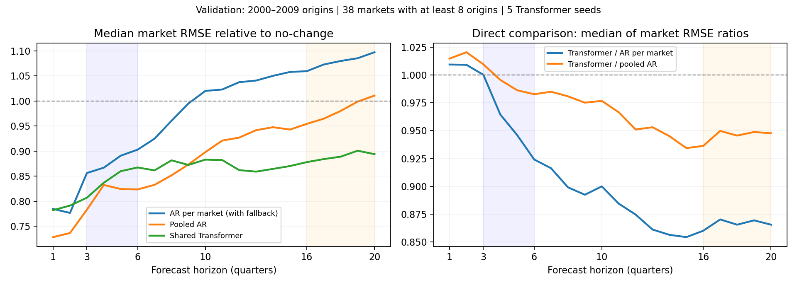

# Multi-Market Housing Price Forecasting

This course project asks whether one shared model can forecast house prices across many countries. We use a small Transformer to explore the foundation model idea, starting with three questions:

1. Can one model work well across different housing markets?
2. How does it compare with fitting a separate model for each market?
3. Does training on more markets help, including for markets left out of training, and how far ahead can it forecast?

We look at forecasts up to 20 quarters ahead. The 3–6 and 16–20 quarter ranges are of particular interest for buying/selling and construction decisions, though we still need to check how accurate the forecasts are at those horizons.

The project started with Taiwan, but the main experiments now cover multiple countries. The [early Taiwan results](docs/taiwan_pilot.md) are kept as background. We are still testing whether this approach offers the benefits of a foundation model.

## Progress

Updated November 4, 2026. Completed validation runs have saved predictions and result tables. Final testing is still to come.

| Question | Experiment or task | Status |
|---|---|---|
| Broad use | Shared Transformer on all national markets, 1–20 quarters, five seeds | Validation done (38 markets reported) |
| One-task-one-model | Per-market AR with pooled fallback; no-change; pooled AR as a shared linear reference | Validation done; includes pooled fallback |
| One-task-one-model | One ARIMA per market | Template ready; fitting and forecasting code still to write |
| One-task-one-model | One Transformer per market (from scratch), and shared pretraining + per-market fine-tuning | Not run yet |
| All | Paired confidence intervals across markets | Not done yet |
| More data | Training pools of 5, 10, 20 and all markets, on a fixed set of evaluation markets | Markets still to choose; not run yet |
| Transfer | Leave-one-market-out: forecast a market never seen in training | Targets still to choose; not run yet |
| Set-up | Training cutoff that does not depend on Taiwan's release date; data checks for every market | In progress ([market list](docs/market_list.csv)) |
| Background | Taiwan pilot (2012–2017, 1–4 quarters) | Done; see [docs/taiwan_pilot.md](docs/taiwan_pilot.md) |
| Optional | Taiwan LLM policy index | Code ready; not yet run on real announcements |

## Multi-market results

**Set-up.** The target is cumulative real house price growth over the next h quarters, for h = 1–20:

```text
y(t, h) = log(HPI_real[t + h] / HPI_real[t])
```

Inputs are the last eight quarters of each market's own real HPI growth. Forecast dates (origins) run from 2000Q1 to 2009Q4. We retrain every four forecast dates, adding newly available observations under the gap and publication rules below. Long-history markets have data going back to the 1960s–1970s. That gives 10 refits. Labels that were not yet published at a block's cutoff are hidden.

These multi-market runs score only 2000–2009 forecast dates. Forecasts reach 20 quarters ahead, so their labels use prices up to 2014. The proposed multi-market test starts in 2015 and has not been run, but it overlaps dates examined in the earlier Taiwan pilot; it is not a fully untouched period for the project.

Predictions cover 41 national markets; we report the 38 with at least eight forecast dates. Markets with short histories only join training once they have published data: the number of markets that actually train rises from 24 in the first refit to 38 in the last ([per-fold counts](docs/market_fold_samples.csv)). Some markets have forecasts before they contribute training samples. We have not yet tested this with a planned leave-one-market-out comparison.

**Results.** For each horizon, we divide the Transformer's RMSE by the baseline's RMSE in each market, then take the median. A ratio below 1 favors the Transformer. Transformer RMSE is averaged over five seeds. The last two columns show median RMSE, in cumulative log-growth units; these are not percentage-point errors in price changes. The ratios are calculated before taking the median, so they cannot be recovered by dividing the last two columns.

The AR baseline fits a separate model for each market where enough labels are available, but uses pooled AR for markets or horizons without enough labels. This means some AR predictions still rely on other markets' data.

| Horizon (quarters) | Shared Transformer / one AR per market | Markets where the shared Transformer is better | Shared Transformer / no-change | One AR per market / no-change | Shared Transformer / pooled AR | Median RMSE: shared Transformer | Median RMSE: one AR per market |
|---|---:|---:|---:|---:|---:|---:|---:|
| 1 | 1.01 | 18/38 | 0.78 | 0.78 | 1.01 | 0.017 | 0.018 |
| 4 | 0.96 | 24/38 | 0.84 | 0.87 | 1.00 | 0.053 | 0.066 |
| 6 | 0.92 | 27/38 | 0.87 | 0.90 | 0.98 | 0.078 | 0.097 |
| 8 | 0.90 | 29/38 | 0.88 | 0.96 | 0.98 | 0.104 | 0.133 |
| 12 | 0.87 | 29/38 | 0.86 | 1.04 | 0.95 | 0.151 | 0.201 |
| 16 | 0.86 | 28/38 | 0.88 | 1.06 | 0.94 | 0.190 | 0.263 |
| 20 | 0.87 | 27/38 | 0.89 | 1.10 | 0.95 | 0.236 | 0.303 |

What we see so far:

- **Short term (1–2 quarters):** the shared model and one AR per market are about the same.
- **Longer horizons:** the shared model does better than per-market AR in about three quarters of markets from 8 quarters onward. At 12–20 quarters, the median RMSE ratio shows a 12–14% improvement. Per-market AR also falls behind no-change at long horizons; the Transformer stays about 10–14% below no-change over 8–20 quarters.
- **Against pooled AR** (one linear model for all markets), the improvement is smaller: about 5% at long horizons. Pooled AR also does better than per-market AR, so we still need to separate the benefit of sharing data from the benefit of using a Transformer.
- **It does not win everywhere.** At h=20, its RMSE is about 1.21 times pooled AR in Taiwan, 1.47 times in Germany and 1.60 times in Mexico. Errors also grow further into the future. Beating a baseline does not tell us whether the 16–20-quarter forecasts are useful for decisions.



Left: median RMSE relative to no-change. Right: median Transformer/AR RMSE ratios. The shaded ranges are 3–6 and 16–20 quarters.

**Limits.** These are validation results from one period that includes the 2008 crisis. There are no confidence intervals yet. The training cutoff is currently set from Taiwan's release lag for all markets; we are changing it to a market-neutral rule and will rerun these comparisons, so the numbers may change. The data-scale and held-out-market experiments are still to do. We also need to agree on the test period before running it, given the overlap with the earlier Taiwan work.

Full tables: [errors by market](results/long_hpi/validation/metrics_by_market.csv), [relative errors](results/long_hpi/validation/relative_by_market.csv), [horizon summary](results/long_hpi/validation/summary_by_horizon.csv) and [history groups](results/long_hpi/validation/summary_by_history.csv).

## Next steps

1. Set training cutoffs without relying on Taiwan's release date, then rerun the comparisons above.
2. More one-model-per-market baselines: ARIMA and a Transformer per market, with fallback use reported separately; shared pretraining + per-market fine-tuning as a separate comparison.
3. Paired confidence intervals across markets.
4. Train on 5, 10, 20 and all markets, keeping the evaluation markets fixed. Record how many markets actually contribute training samples in each run.
5. Choose 3–5 markets in advance and leave each one out of training to test transfer.

## Data and backtest notes

Raw and processed source tables are in `data/raw/` and `data/processed/`. Taiwan HPI/CPI and global AnaHPI were copied from the Spring 2026 dataset. Generated panels go in `data/interim/` and can be rebuilt locally.

Taiwan HPI is currently treated as nominal and deflated with CPI; its price basis still needs confirmation. Taiwan credit / GDP uses bank consumer loans divided by the latest four quarters of nominal GDP. Its coverage is narrower than the overseas household-credit measure. Publication lags are provisional; the draft evidence is in [availability_matrix.csv](results/availability_matrix.csv). The data contain later revisions, rather than the versions originally released.

Both studies use an expanding training window and refit every four forecast dates. All countries share a calendar cutoff, currently set from Taiwan's HPI release lag; this is being changed to a market-neutral rule. Unpublished training labels are hidden, and input scaling is fitted on the training fold. The long-horizon setup keeps a four-quarter gap and masks unavailable longer-horizon labels separately.

The Taiwan pilot uses 2012–2017 validation origins, a 2018 buffer and a test starting in 2019. Its confidence intervals use four-quarter circular bootstrap blocks. The multi-market setup uses 2000–2009 validation origins and a proposed test from 2015. Test runs stay locked by default.

Keep each prediction CSV beside its `.meta.json` file. The metadata record features, dates, seeds and data fingerprints so the evaluator can check that runs are comparable.

## Run locally

Use Python 3.11, from the repository root:

```bash
conda create -n hpf python=3.11 -y
conda activate hpf
pip install -e ".[dev,dl]"
pytest -q
python scripts/build_panel.py
```

Multi-market validation:

```bash
C=configs/experiment_long.toml
python scripts/run_backtest.py --config $C --models no_change ar ar_pooled --pool national --experiment long_hpi
python scripts/run_backtest.py --config $C --models transformer --pool national --experiment long_hpi
python scripts/evaluate_markets.py results/long_hpi/validation/preds_*.csv --config $C --reference no_change__national
```

This writes market-level tables, summaries and a relative-RMSE plot when Matplotlib is installed. Other multi-market tools:

```bash
python scripts/build_market_list.py   # docs/market_list.csv and per-fold training samples
pip install statsmodels               # then fill the TODO(B) parts of src/housing_forecast/models/arima.py
python scripts/run_backtest.py --config $C --models arima --pool national --experiment long_hpi   # also writes diag_arima__national.csv
```

The two-panel comparison above also includes direct Transformer/AR ratios calculated from `relative_by_market.csv`.

The earlier Taiwan runs and their commands are in [the Taiwan pilot notes](docs/taiwan_pilot.md). Plain `ar` uses per-market fits with pooled fallback; `ar_pooled` uses one shared fit. Transformer training selects the epoch count on a time split inside each fold, then retrains on that fold's full training set.

## Optional policy index

As an optional extension, we plan to use a local LLM to identify tightening and easing signals in Taiwan policy announcements. The code and a template for a manually checked timeline are ready. We still need to collect the announcements and run the model. The forecasting experiments take priority.

Settings are in [policy.toml](configs/policy.toml), with input formats in [the policy data notes](data/raw/policy/README.md). Announcements are grouped by publication quarter; availability at each forecast date still needs checking before the index can be used as an input.

```bash
python scripts/policy_pipeline.py --backend mock extract
# Requires vLLM and a GPU, after collecting the input data
python scripts/policy_pipeline.py --backend vllm extract --limit 20
python scripts/policy_pipeline.py --backend vllm index
python scripts/policy_pipeline.py --backend vllm eval
python scripts/policy_pipeline.py --backend vllm spotcheck-export
```

## Code and notes

`src/housing_forecast/` contains data readers, backtesting, models, evaluation and policy extraction. Commands are in `scripts/`, checks in `tests/`, and outputs in `results/<experiment>/<phase>/`.

See [experiment settings](docs/experiment_contract.md), [backtest notes](docs/backtest_framework.md) and [data formats](docs/design_notes.md) for more detail. The original course milestones are November 12 for baselines, November 19 for Transformer comparisons, November 26 for analysis and December 10 for the report. Initial validation runs are done; final checks and the report are still in progress.
