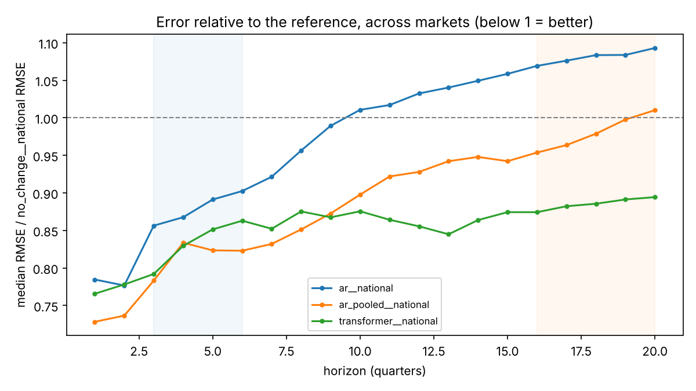

# Multi-Market Housing Price Forecasting

This course project asks whether one shared model can forecast house prices across many countries. We use a small Transformer to explore the foundation model idea, starting with three questions:

1. Can one model work well across different housing markets?
2. How does it compare with fitting a separate model for each market?
3. Does training on more markets help, including for markets left out of training, and how far ahead can it forecast?

We look at forecasts up to 20 quarters ahead. The 3–6 and 16–20 quarter ranges are of particular interest for buying/selling and construction decisions, though we still need to check how accurate the forecasts are at those horizons.

The project started with Taiwan, but the main experiments now cover multiple countries. The [early Taiwan results](docs/taiwan_pilot.md) are kept as background. We are still testing whether this approach offers the benefits of a foundation model.

## Progress

Updated November 5, 2026. Completed validation runs have saved predictions and result tables. Final testing is still to come.

| Question | Experiment or task | Status |
|---|---|---|
| Broad use | Shared Transformer on all national markets, 1–20 quarters, five seeds | Validation done (38 markets reported) |
| One-task-one-model | Per-market AR with pooled fallback; no-change; pooled AR as a shared linear reference | Validation done; includes pooled fallback |
| One-task-one-model | One ARIMA per market | Template ready; fitting and forecasting code still to write |
| One-task-one-model | One Transformer per market (from scratch), and shared pretraining + per-market fine-tuning | Not run yet |
| Accuracy | Paired confidence intervals for the shared Transformer vs per-market AR, pooled AR and no-change | Done on validation |
| More data | Training pools of 5, 10, 20 and all markets, on a fixed set of evaluation markets | Markets still to choose; not run yet |
| Transfer | Leave-one-market-out: forecast a market never seen in training | Targets still to choose; not run yet |
| Set-up | Common forecast date based on the slowest configured HPI release | Done. Multi-market validation rerun |
| Background | Taiwan pilot (2012–2017, 1–4 quarters) | Done; see [docs/taiwan_pilot.md](docs/taiwan_pilot.md) |
| Optional | Taiwan LLM policy index | Code ready; not yet run on real announcements |

## Multi-market results

**Set-up.** The target is cumulative real house price growth over the next h quarters, for h = 1–20:

```text
y(t, h) = log(HPI_real[t + h] / HPI_real[t])
```

The model uses the last eight quarters of each market's real HPI growth. Validation covers 2000Q1 to 2009Q4, with a refit every four quarters. All markets use the same forecast date for a given quarter, set to quarter-end plus the slowest configured HPI release lag (100 days in this run). Each market keeps its own release lag for training labels.

These multi-market runs score only 2000–2009 forecast dates. Forecasts reach 20 quarters ahead, so their labels use prices up to 2014. The proposed multi-market test starts in 2015 and has not been run, but it overlaps dates examined in the earlier Taiwan pilot; it is not a fully untouched period for the project.

Predictions cover 41 national markets; we report the 38 with at least eight forecast dates. The training pool grows from 24 markets in the first refit to 38 in the last as more data become available. We still need to test transfer by holding out entire markets.

We calculate RMSE for each seed and average over five seeds for the Transformer. To compare models, we take the RMSE ratio in each market and report the median across markets. A ratio below 1 favors the model in the numerator. The last two columns show absolute RMSE in cumulative log-growth units.

Per-market AR fits a separate model where there are enough training labels. It uses pooled AR as a fallback for markets or horizons with too few labels.

| Quarters ahead | Transformer / per-market AR | Markets beating per-market AR | Transformer / no-change | Per-market AR / no-change | Transformer / pooled AR | Median RMSE (Transformer) | Median RMSE (per-market AR) |
|---|---:|---:|---:|---:|---:|---:|---:|
| 1 | 0.997 | 20/38 | 0.766 | 0.785 | 1.012 | 0.017 | 0.018 |
| 4 | 0.967 | 25/38 | 0.830 | 0.868 | 0.984 | 0.053 | 0.066 |
| 5 | 0.947 | 25/38 | 0.851 | 0.891 | 0.976 | 0.065 | 0.083 |
| 6 | 0.933 | 26/38 | 0.863 | 0.902 | 0.978 | 0.077 | 0.097 |
| 8 | 0.912 | 29/38 | 0.875 | 0.956 | 0.983 | 0.104 | 0.132 |
| 12 | 0.861 | 29/38 | 0.855 | 1.032 | 0.957 | 0.152 | 0.200 |
| 16 | 0.854 | 28/38 | 0.874 | 1.069 | 0.954 | 0.191 | 0.263 |
| 20 | 0.863 | 27/38 | 0.894 | 1.093 | 0.958 | 0.235 | 0.304 |

The table below gives the median RMSE ratio and 95% confidence interval for each forecast range. Within a range, we combine the errors across horizons before calculating each market's RMSE. For each of the 2,000 bootstrap draws, we resample the same blocks of 20 forecast quarters for both models and all markets.

| Baseline | 3–6 quarters | 16–20 quarters |
|---|---:|---:|
| Per-market AR | 0.943 [0.883, 0.977] | 0.869 [0.795, 0.949] |
| Pooled AR | 0.978 [0.918, 1.058] | 0.953 [0.917, 1.005] |
| No-change | 0.849 [0.649, 0.979] | 0.889 [0.831, 1.027] |

- **Per-market AR.** The two models are about even one quarter ahead. From 5 through 20 quarters, the Transformer's ratio stays below 1 across the full confidence interval at each horizon. Over 16–20 quarters, its median ratio is 0.869, or about 13% lower RMSE.
- **Pooled AR.** The Transformer has about 5% lower RMSE over 16–20 quarters. The interval just crosses 1 (0.917 to 1.005), so the two models could be about even.
- **No-change.** The Transformer has lower RMSE over 3–6 quarters, with the full interval below 1. Its ratio is still below 1 over 16–20 quarters, but the interval crosses 1. Per-market AR falls behind no-change from 10 quarters onward and reaches a ratio of 1.093 at 20 quarters.



The shaded ranges show 3–6 and 16–20 quarters. Absolute errors grow with the horizon, so we still need to check whether the long forecasts are accurate enough to use. These results come from one validation period, which includes the 2008 crisis. The experiments on training pool size and held-out markets are still to come.

See the [market errors](results/long_hpi/validation/metrics_by_market.csv), [relative errors](results/long_hpi/validation/relative_by_market.csv), [horizon summary](results/long_hpi/validation/summary_by_horizon.csv) and [history groups](results/long_hpi/validation/summary_by_history.csv). The full confidence intervals are in the comparison files for [per-market AR](results/long_hpi/validation/ratio_ci_transformer__national_vs_ar__national.csv), [pooled AR](results/long_hpi/validation/ratio_ci_transformer__national_vs_ar_pooled__national.csv), [no-change](results/long_hpi/validation/ratio_ci_transformer__national_vs_no_change__national.csv).

## Next steps

1. Run ARIMA and a separate Transformer for each market, and report where they use a fallback. Compare shared pretraining with fine-tuning as a separate run.
2. Train on 5, 10, 20 and all markets, keeping the evaluation markets fixed. Record how many markets actually contribute training samples in each run.
3. Choose 3–5 markets in advance and leave each one out of training to test transfer.

## Data and backtest notes

Raw and processed source tables are in `data/raw/` and `data/processed/`. Taiwan HPI/CPI and global AnaHPI were copied from the Spring 2026 dataset. Generated panels go in `data/interim/` and can be rebuilt locally.

Taiwan HPI is currently treated as nominal and deflated with CPI; its price basis still needs confirmation. Taiwan credit / GDP uses bank consumer loans divided by the latest four quarters of nominal GDP. Its coverage is narrower than the overseas household-credit measure. Publication lags are provisional; the draft evidence is in [availability_matrix.csv](results/availability_matrix.csv). The data contain later revisions, rather than the versions originally released.

Both studies use an expanding training window and refit every four forecast dates. The multi-market run uses the first forecast date in each fold as its training cutoff and keeps a four-quarter gap between training and validation origins. Input scaling is fitted on the training fold. The Taiwan pilot uses its original release timing.

The Taiwan pilot uses 2012–2017 validation origins, a 2018 buffer and a test starting in 2019. Its confidence intervals use four-quarter circular bootstrap blocks. The multi-market setup uses 2000–2009 validation origins and a proposed test from 2015. Test runs stay locked by default.

Keep each prediction CSV beside its `.meta.json` file. The metadata record features, dates, seeds and data fingerprints so the evaluator can check that runs are comparable.

## Run locally

Use Python 3.11, from the repository root:

```bash
conda create -n hpf python=3.11 -y
conda activate hpf
pip install -e ".[dev,dl]"
pytest -q
python scripts/build_panel.py
```

Multi-market validation:

```bash
C=configs/experiment_long.toml
python scripts/run_backtest.py --config $C --models no_change ar ar_pooled --pool national --experiment long_hpi
python scripts/run_backtest.py --config $C --models transformer --pool national --experiment long_hpi
python scripts/evaluate_markets.py results/long_hpi/validation/preds_*.csv --config $C --reference no_change__national \
    --compare transformer__national ar__national \
    --compare transformer__national ar_pooled__national \
    --compare transformer__national no_change__national
```

This writes the error tables, confidence intervals and a plot if Matplotlib is installed. Other multi-market tools:

```bash
python scripts/build_market_list.py   # docs/market_list.csv and per-fold training samples
pip install statsmodels               # then fill the TODO(B) parts of src/housing_forecast/models/arima.py
python scripts/run_backtest.py --config $C --models arima --pool national --experiment long_hpi   # also writes diag_arima__national.csv
```

The earlier Taiwan runs and their commands are in [the Taiwan pilot notes](docs/taiwan_pilot.md). Plain `ar` uses per-market fits with pooled fallback; `ar_pooled` uses one shared fit. Transformer training selects the epoch count on a time split inside each fold, then retrains on that fold's full training set.

## Optional policy index

As an optional extension, we plan to use a local LLM to identify tightening and easing signals in Taiwan policy announcements. The code and a template for a manually checked timeline are ready. We still need to collect the announcements and run the model. The forecasting experiments take priority.

Settings are in [policy.toml](configs/policy.toml), with input formats in [the policy data notes](data/raw/policy/README.md). Announcements are grouped by publication quarter; availability at each forecast date still needs checking before the index can be used as an input.

```bash
python scripts/policy_pipeline.py --backend mock extract
# Requires vLLM and a GPU, after collecting the input data
python scripts/policy_pipeline.py --backend vllm extract --limit 20
python scripts/policy_pipeline.py --backend vllm index
python scripts/policy_pipeline.py --backend vllm eval
python scripts/policy_pipeline.py --backend vllm spotcheck-export
```

## Code and notes

`src/housing_forecast/` contains data readers, backtesting, models, evaluation and policy extraction. Commands are in `scripts/`, checks in `tests/`, and outputs in `results/<experiment>/<phase>/`.

See [experiment settings](docs/experiment_contract.md), [backtest notes](docs/backtest_framework.md) and [data formats](docs/design_notes.md) for more detail. The original course milestones are November 12 for baselines, November 19 for Transformer comparisons, November 26 for analysis and December 10 for the report. Initial validation runs are done; final checks and the report are still in progress.
